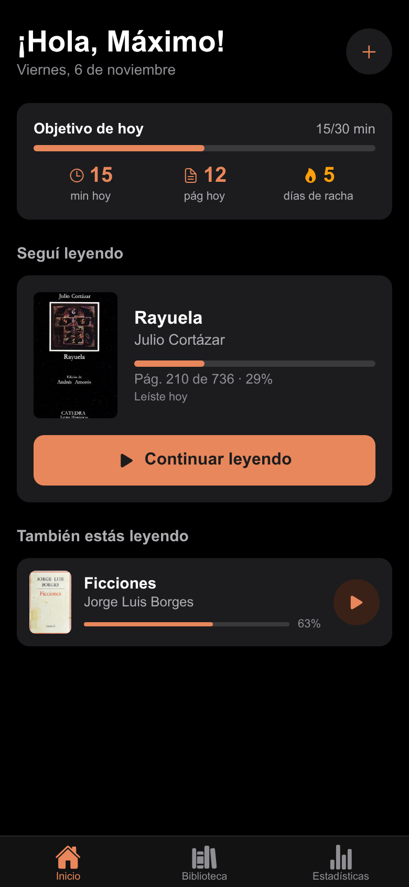
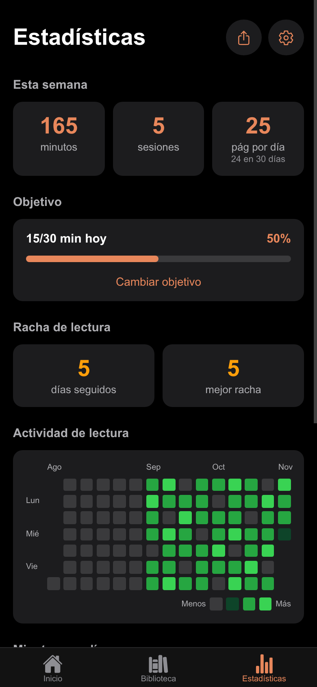

# Lectito

A private reading tracker built with React Native and Expo: log reading
sessions, track progress and streaks, keep quotes, and read ePub books, all
stored on the device. Think "Strava for readers" without the social network.

> **Status:** personal project in use on my Android phone. The UI is in
> Spanish.

<p>
  
  
  
  
</p>

## What it does

- Library with Want to Read, Reading, Read and Did Not Finish shelves, custom
  lists, tags, ratings and reviews; search and filters.
- Add books by ISBN barcode scan or text search (Open Library, Google Books),
  or import an ePub.
- Timed reading sessions with pause, pages read and notes; streaks, a
  heatmap, books per month and daily or weekly goals.
- Built-in ePub reader with themes, fonts, saved position and highlights.
- Quotes and shareable cards, without accounts or a feed.

## Technical highlights

- **Local-first, no backend.** All data lives on the device; the only network
  calls are book lookups and recommendations, and the screens that make them
  say so.
- **Versioned local data.** Stored data carries a schema version; pending
  migrations run before any store loads and are saved in one write, and data
  from a newer app version is refused instead of overwritten.
- **Atomic writes.** A session and the book progress it updates are written in
  one storage call; a backup restore replaces every store in one write and
  only updates memory after it succeeds.
- **Offline ePub reader.** epub.js and JSZip are bundled, so books open in
  airplane mode.
- **Portable backups.** A versioned JSON format that includes ePub files and
  lists; older formats still import.
- **Tested.** 85 Jest tests covering storage failures, backups, migrations
  and statistics; CI runs lint, type-checking and tests.

**Stack:** React Native 0.86, Expo SDK 57, Expo Router, TypeScript (strict),
Zustand, AsyncStorage, epub.js, Jest, EAS Build, GitHub Actions.

## Run

```bash
npm install
npm start                        # Expo dev server; press a for Android
npm test
npm run lint && npm run typecheck
```

Build an installable APK with `eas build -p android --profile preview`.

## Structure

- `app/`: screens, with file-based routes.
- `components/`: shared UI.
- `store/`: Zustand stores and persistence.
- `lib/`: book APIs, ePub, statistics, backups and migrations.
- `types/`: data models, the source of truth for the stored schema.

## Privacy

Book search and barcode scans send the query or ISBN to Open Library and
Google Books; recommendations send the chosen books' ISBNs and authors to
Open Library. Backups are plain JSON and are not encrypted.
